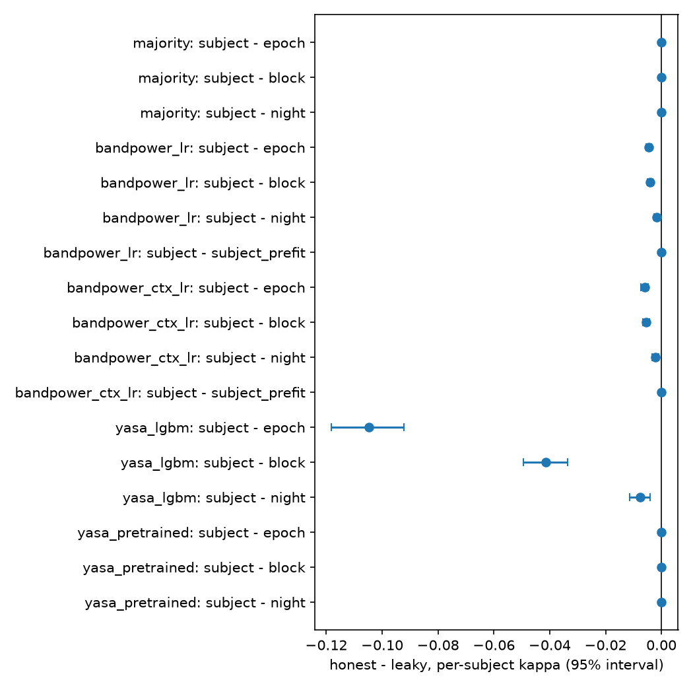
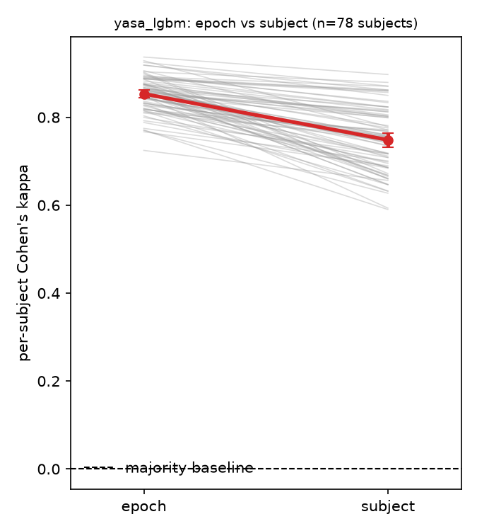

# Sleep staging leakage audit

Checks how much a sleep-staging AI score depends on a leaky evaluation, by comparing an honest subject-wise test against random and partly grouped splits on the same open data.

**The protocol is pre-registered:** [docs/preregistration.md](docs/preregistration.md), frozen at git tag `prereg-v1` before any full-data model run.

## Why this matters

A sleep-tracking product or research model can report a high accuracy number that was measured with the same person's nights in both training and test data. That number does not show how the model will work on a new person. This project measures the gap on open data so anyone reading a sleep-AI accuracy claim can ask whether it was tested on new people.

## Scope

- Not a medical tool. It makes no clinical claims of any kind.
- Uses only public, de-identified data. No recruitment of people.
- Compares evaluation methods, not a product.

## Quickstart

```bash
uv sync --locked
uv run python -m sleepaudit all --config configs/sc78.yaml   # primary: 78 subjects, 7.6 GB download
uv run python -m sleepaudit all --config configs/sc20.yaml   # secondary: subjects 0-19
uv run python -m sleepaudit all --config configs/ci.yaml     # 4-subject fixture (~400 MB), runs in CI
```

- **Data directory:** data go to `$SLEEPAUDIT_DATA` (default `~/sleepaudit_data`), outside the repository.
- **Results:** written to `results/<config name>/`.
- **Steps:** `all` runs `fetch-labels`, `fetch-psg`, `features`, `evaluate` and `report`. Each can also be run on its own.
- **Gate:** `sc20` and `sc78` refuse to run unless the `prereg-v1` tag is in the current history.
- **Tests:** `uv run pytest` runs the tests. Tests that need data are skipped when it is absent; set `SLEEPAUDIT_REQUIRE_DATA=1` to make them fail instead.

## Data

[Sleep-EDF Expanded](https://physionet.org/content/sleep-edfx/1.0.0/) 1.0.0 (PhysioNet; ODC-By 1.0), **Sleep Cassette files only**. See the [data card](docs/data_card.md).

- **Primary:** `sc78`, all 78 SC subjects and 153 recordings, 10-fold.
- **Secondary:** `sc20`, subjects 0–19 and 39 recordings, 20-fold, which makes the subject-wise arm leave-one-subject-out.
- **Signal and labels:** single-channel `EEG Fpz-Cz` at 100 Hz (plus `EOG horizontal` for YASA) and 30-s epochs. R&K stages 3 and 4 are merged into N3, and movement and unscored epochs are dropped.
- **Wake trimming:** wake is kept for 30 minutes on each side of sleep. This reproduces the published 42,308 and 195,479 epochs exactly.
- **Downloads:** files are checked against PhysioNet's SHA256 sums, with an AWS mirror as fallback.

## Models

1. **`majority`**: always predicts the most common stage (κ = 0).
2. **`bandpower_lr`**: relative band power of the current epoch, then logistic regression.
3. **`bandpower_ctx_lr`**: the same, plus band power of the two epochs on each side.
4. **`yasa_lgbm`**: [YASA](https://github.com/raphaelvallat/yasa) 0.8.1 features (smoothed over several minutes), then LightGBM with YASA's published settings, retrained in each fold.
5. **`yasa_pretrained`**: YASA's own classifier, which never saw Sleep-EDF. It is never trained here, so its score must be identical under every split: a built-in check on the evaluation code.

All hyperparameters are fixed in advance; nothing is tuned. Pretrained U-Sleep is excluded because it was trained on at least 75% of Sleep-EDF. The [model info sheet](docs/model_info_sheet.md) explains that exclusion and the case for leak-free training in the honest arm.

## Evaluation protocol

The same models, features, seeds (0–4) and number of folds are used in every arm; only the split rule changes.

| Arm | Held out together | What still leaks |
|---|---|---|
| `epoch` | single 30-s epochs | neighbouring epochs, the night, the person |
| `block` | 30-minute blocks, with an 8-epoch buffer dropped around each | the night, the person |
| `night` | whole recordings | the person's other night |
| `subject` (honest) | all of a person's nights | nothing |
| `subject_prefit` | as `subject`, but the scaler is fitted on all data first | scaling statistics |

- **Primary outcome:** per-subject Cohen's κ. The headline is the paired per-subject difference (honest minus leaky), with a 95% subject-level bootstrap interval.
- **Secondary outcomes:** pooled metrics, per-class F1, confusion matrices, calibration error, accuracy by distance to the nearest stage change, and night-level fragmentation.
- **Hypotheses, decision rules, expected sizes and pipeline-failure criteria** are in the [pre-registration](docs/preregistration.md). The [REFORMS checklist](docs/reforms_checklist.md) maps each reporting item to where it is addressed.

## Results

Full runs on one machine (the GPU server), commit `30f4a5f`, descended from the tag `prereg-v1`. The figures were regenerated from the same `per_subject.csv` after a plotting fix (commit `b072949`, [deviations log](docs/preregistration.md)); every CSV is exactly as the server wrote it. All three pipeline-failure checks in `meta.json` passed for both datasets (`honest_folds_subject_disjoint`, `yasa_pretrained_split_invariant`, `epoch_counts_match_published`), and `dirty` is `false`. They were read before any score. Raw outputs are in [`results/sc78/`](results/sc78) and [`results/sc20/`](results/sc20). No subject was dropped from any paired contrast (`n_dropped = 0`).

### SC-78 (primary: 78 subjects, 153 nights, 10-fold)

Per-subject Cohen's κ (mean over subjects, each subject first averaged over 5 seeds). The last two columns are the paired `subject` − `epoch` gap and its 95% subject-bootstrap interval (`summary.csv`).

| Model | `epoch` | `block` | `night` | `subject` | `subject_prefit` | Gap (`subject` − `epoch`) | 95% interval |
|---|---|---|---|---|---|---|---|
| `majority` | 0.000 | 0.000 | 0.000 | 0.000 | – | +0.000 | [+0.000, +0.000] |
| `bandpower_lr` | 0.453 | 0.453 | 0.450 | 0.449 | 0.449 | -0.004 | [-0.005, -0.003] |
| `bandpower_ctx_lr` | 0.502 | 0.501 | 0.498 | 0.495 | 0.495 | -0.006 | [-0.007, -0.005] |
| `yasa_lgbm` | 0.853 | 0.790 | 0.756 | 0.749 | – | -0.105 | [-0.118, -0.092] |
| `yasa_pretrained` | 0.704 | 0.704 | 0.704 | 0.704 | – | +0.000 | [+0.000, +0.000] |

Accuracy (same averaging; no interval is pre-registered for accuracy gaps).

| Model | `epoch` | `block` | `night` | `subject` | `subject_prefit` | `subject` − `epoch` (points) |
|---|---|---|---|---|---|---|
| `majority` | 0.375 | 0.375 | 0.375 | 0.370 | – | -0.5 |
| `bandpower_lr` | 0.593 | 0.593 | 0.591 | 0.589 | 0.589 | -0.4 |
| `bandpower_ctx_lr` | 0.631 | 0.630 | 0.628 | 0.626 | 0.626 | -0.5 |
| `yasa_lgbm` | 0.898 | 0.854 | 0.830 | 0.825 | – | -7.3 |
| `yasa_pretrained` | 0.794 | 0.794 | 0.794 | 0.794 | – | +0.0 |

### SC-20 (secondary: 20 subjects, 39 nights, 20-fold)

Per-subject Cohen's κ (mean over subjects, each subject first averaged over 5 seeds). The last two columns are the paired `subject` − `epoch` gap and its 95% subject-bootstrap interval (`summary.csv`).

| Model | `epoch` | `block` | `night` | `subject` | `subject_prefit` | Gap (`subject` − `epoch`) | 95% interval |
|---|---|---|---|---|---|---|---|
| `majority` | 0.000 | 0.000 | 0.000 | 0.000 | – | +0.000 | [+0.000, +0.000] |
| `bandpower_lr` | 0.553 | 0.551 | 0.542 | 0.537 | 0.537 | -0.016 | [-0.023, -0.010] |
| `bandpower_ctx_lr` | 0.608 | 0.606 | 0.596 | 0.591 | 0.591 | -0.018 | [-0.022, -0.013] |
| `yasa_lgbm` | 0.899 | 0.847 | 0.818 | 0.809 | – | -0.091 | [-0.114, -0.070] |
| `yasa_pretrained` | 0.765 | 0.765 | 0.765 | 0.765 | – | +0.000 | [+0.000, +0.000] |

Accuracy (same averaging; no interval is pre-registered for accuracy gaps).

| Model | `epoch` | `block` | `night` | `subject` | `subject_prefit` | `subject` − `epoch` (points) |
|---|---|---|---|---|---|---|
| `majority` | 0.424 | 0.424 | 0.424 | 0.424 | – | +0.0 |
| `bandpower_lr` | 0.660 | 0.658 | 0.650 | 0.647 | 0.647 | -1.3 |
| `bandpower_ctx_lr` | 0.704 | 0.702 | 0.694 | 0.690 | 0.690 | -1.4 |
| `yasa_lgbm` | 0.929 | 0.891 | 0.870 | 0.864 | – | -6.5 |
| `yasa_pretrained` | 0.829 | 0.829 | 0.829 | 0.829 | – | +0.0 |

Across the 5 seeds, the mean κ of any model and arm varies by at most 0.007 on SC-78 and 0.003 on SC-20 (seeds are a stability range, not extra samples).



*Forest plot for SC-78: honest minus leaky per-subject κ with 95% subject-bootstrap intervals (`results/sc78/figures/forest.png`).*



*`yasa_lgbm` on SC-78: each grey line is one subject; the red line is the mean with a 95% interval. The other models' slopegraphs are in `results/sc78/figures/` and `results/sc20/figures/`.*

### Hypotheses, by the pre-registered rules

The rules are in [A9 of the pre-registration](docs/preregistration.md). H1 is the single primary hypothesis. H2–H4 are secondary and carry no multiplicity correction. The post-freeze deviations log has one entry, a plotting fix that changes no number.

**H1: every trained model scores lower under `subject` than under `epoch`.** Rule: the interval of the mean paired κ difference lies entirely below 0.

| Dataset | `bandpower_lr` | `bandpower_ctx_lr` | `yasa_lgbm` | Headline rule (≥ 2 of 3 on SC-78) |
|---|---|---|---|---|
| SC-78 | holds (−0.004, hi −0.003) | holds (−0.006, hi −0.005) | holds (−0.105, hi −0.092) | **met, 3 of 3** |
| SC-20 (secondary) | holds (−0.016, hi −0.010) | holds (−0.018, hi −0.013) | holds (−0.091, hi −0.070) | not used for the headline |

- **Size against the pre-registered expectation.** The expected size was 0.07–0.12 κ for the feature models, inferred from the literature and not a decision rule. `yasa_lgbm` is inside that range on both datasets (−0.105 and −0.091). The two band-power logistic-regression models are far below it: −0.004 and −0.006 κ on SC-78, −0.016 and −0.018 on SC-20 (accuracy −0.4 to −0.5 points on SC-78, −1.3 to −1.4 on SC-20). The direction matches H1 and the intervals exclude 0, but the effect is small. This audit did not test why; one untested possibility is that a linear model on 5 or 25 features has little capacity to memorise a person.
- **`subject_prefit`.** Fitting the scaler on all data before the split changes κ by less than 0.0002 on both datasets, and every interval includes 0 (SC-78 `bandpower_lr` +0.00002, [−0.00005, +0.00008]; SC-20 −0.00014, [−0.00035, +0.00007]). This is the near-zero result the pre-registration expected.
- **Controls.** `majority` has κ = 0 in every arm, and `yasa_pretrained` has identical per-subject scores in every arm and seed.

**H2: the gap shrinks in the order `epoch` ≥ `block` ≥ `night` ≥ `subject`.** Supported for all three trained models on both datasets: all three adjacent mean differences are ≤ 0 and no interval lies above 0. Every step's interval lies entirely below 0, so every step is resolved. Most of the `yasa_lgbm` drop is in the first two steps (SC-78: `block` − `epoch` −0.064, `night` − `block` −0.034, `subject` − `night` −0.008). For the band-power models the steps are 0.0005 to 0.003 on SC-78 and up to 0.010 on SC-20. The `night` arm is diluted by design (pre-registration B5), so the `subject` − `night` step is biased towards 0.

**H3: the gap is larger for `bandpower_ctx_lr` and `yasa_lgbm` than for `bandpower_lr`.** Rule: the interval of the gap difference lies entirely below 0.

| Dataset | `bandpower_ctx_lr` minus `bandpower_lr` | `yasa_lgbm` minus `bandpower_lr` |
|---|---|---|
| SC-78 | supported (−0.0016, [−0.0023, −0.0008]) | supported (−0.100, [−0.114, −0.088]) |
| SC-20 | not supported (−0.0019, [−0.0058, +0.0025]) | supported (−0.075, [−0.097, −0.054]) |

**H4: the leaky gain concentrates in stable epochs.** Rule: the interval of (`epoch` − `subject` accuracy gain in the stable stratum) minus (the same in the `0-1` stratum) lies entirely above 0.

| Dataset | `bandpower_lr` | `bandpower_ctx_lr` | `yasa_lgbm` |
|---|---|---|---|
| SC-78 | supported (+0.0024, [+0.0011, +0.0038]) | supported (+0.0019, [+0.0003, +0.0036]) | not supported (−0.0038, [−0.0123, +0.0050]) |
| SC-20 | supported (+0.0083, [+0.0016, +0.0152]) | not supported (+0.0045, [−0.0024, +0.0113]) | not supported (−0.0475, [−0.0590, −0.0339]) |

Where H4 is supported, the difference is a quarter to under a point of accuracy. For `yasa_lgbm` on SC-20 the interval lies entirely below 0: the stable-minus-`0-1` gain is smaller, the opposite direction to H4. The rule does not define "contradicted" for H4, so this is reported as not supported, with the direction stated.

Descriptive tables that carry no decision rule (`pooled.csv`, `confusion.csv`, `strata.csv`, `nights.csv`, `per_subject.csv`) are in the results folders.

## Limitations

- **Single scorer per night, R&K labels.** The reference is one human scorer using the 1968 rules. Scorers agree with a consensus on about 83% of epochs and on about 63% for N1, so no score here is accuracy against a truth.
- **Age structure.** Sleep Cassette has no subject aged 35–49. SC-20 is a young, uniform cohort (25–34), SC-78 is mostly older. Their results are not interchangeable, and the SC-20 versus SC-78 comparison is confounded with age and with K.
- **YASA domain shift.** `yasa_pretrained` was trained on other cohorts, so its level (κ 0.70 on SC-78, 0.76 on SC-20) says nothing about a model trained on these data. It serves as a split-invariance control. YASA's classifier also unpickles with an `InconsistentVersionWarning` under scikit-learn 1.9.1.
- **Intervals reflect subject sampling only.** They describe which subjects were tested, not variation in the training sets. Seeds are a stability range.
- **The `night` arm is diluted** (some subjects have both nights in one test fold), and the `block` arm trains on up to 2.4 percentage points fewer rows (SC-78). Both are stated in pre-registration B5.
- **Trimming and `time_hour`/`time_norm`.** Wake trimming uses the reference labels, which raises absolute scores equally in every arm (B5).
- **Few models.** Three trained models, two of them linear on band power. No deep model was trained, so nothing here says how large the gap is for deep networks.
- **No external dataset.** All results come from one database, Sleep-EDF Sleep Cassette, and are not evidence about any other dataset or device.
- **Scope.** This is a study of evaluation methods, not a medical tool.

## Decisions (formerly open questions)

- **Expected size of the gap:** modest. The one controlled measurement on Sleep-EDF (Köksal 2026, SC-78) found about 0.10 macro-F1 and 0.11 κ between random epoch-wise and subject-wise splits, far below the near-100% vs 55–85% gaps reported for EEG disease-classification tasks. The pre-registration commits to 0.07–0.12 κ for the feature models, and to 1–2 accuracy points for night-wise vs subject-wise.
- **Sleep-EDF-20 or -78:** both, from one download. SC-78 is primary: twice as many subjects narrow the interval, and it matches Köksal. SC-20 is secondary and literature-comparable.
- **U-Sleep:** not used. Its pretrained weights saw most of Sleep-EDF, are not public, and the API was unreachable. Training it from scratch is possible future work, as a separately pre-registered addendum.

## Deliverables

- A repository that runs with one command.
- A results table: each model under each arm, with the honest-minus-leaky gap and its interval (see Results).
- A GitHub Actions workflow that runs unit tests, the label-count checks on all 153 hypnograms, and the 4-subject fixture.
- The pre-registration, written and tagged before the final run.
- A limitations section (see Limitations).

## Background sources

- **Leakage taxonomy:** Kapoor & Narayanan, <https://arxiv.org/html/2207.07048v1>. REFORMS: <https://reforms.cs.princeton.edu/>.
- **The gap on Sleep-EDF:** Köksal (2026), <https://dergipark.org.tr/en/download/article-file/5192156>.
- **Leakage in EEG deep learning:** Del Pup et al., <https://arxiv.org/html/2505.13021v1>. The gap was large on disease-classification tasks.
- **Subject-wise protocols on Sleep-EDF:**
  - DeepSleepNet: <https://arxiv.org/abs/1703.04046>
  - XSleepNet: <https://arxiv.org/abs/2007.05492>
  - SleepTransformer: <https://arxiv.org/abs/2105.11043>
- **YASA's weakness on fragmented sleep,** flagged by a peer reviewer: <https://doi.org/10.7554/eLife.70092.sa2>.
- **Full research notes:** [reports/Sleep staging leakage audit setup.md](reports/Sleep%20staging%20leakage%20audit%20setup.md).

## Timeline (estimate, not measured)

2–4 weeks.
